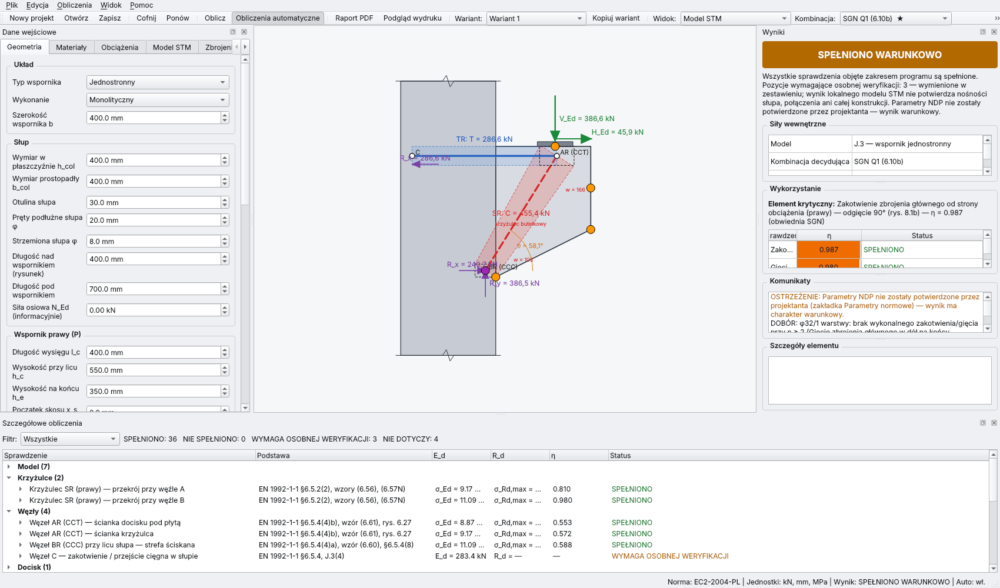
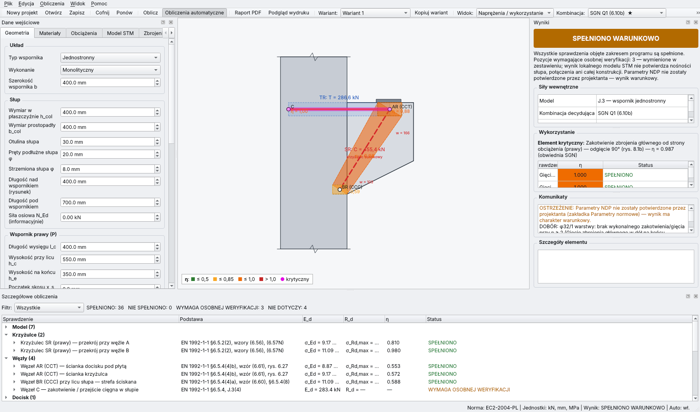

# KRÓTKI WSPORNIK ST

Aplikacja inżynierska do projektowania, wymiarowania i sprawdzania **krótkich wsporników żelbetowych metodą
Strut-and-Tie** wg **PN-EN 1992-1-1** (EN 1992-1-1:2004 + AC:2010, polski Załącznik Krajowy) — §5.6.4, §6.5,
zał. J.3, rozdz. 8 i 9.

> Wyniki programu wymagają weryfikacji przez uprawnionego projektanta. Pozytywny wynik lokalnego modelu STM nie
> potwierdza nośności słupa, połączenia ani całej konstrukcji.



## Możliwości

| Obszar | Zakres |
|---|---|
| Geometrie | wspornik jednostronny i dwustronny, stała / zmienna wysokość, ukośna dolna krawędź (skos od x_s), monolityczny / prefabrykowany, płyta stalowa / łożysko / oparcie bezpośrednie |
| Obciążenia | V, H (oba znaki), M, mimośrody e_x, e_y; oddziaływania charakterystyczne i obliczeniowe; kombinacje EN 1990 (6.10) lub (6.10a/b), SGU; blokada podwójnego stosowania γ; import CSV/Excel |
| Silnik STM | automatyczny model J.5 z jawnym doborem pola naprężeń (x_c), ogólny solver kratownic (rząd macierzy, niewyznaczalność, mechanizmy, residua), model ręczny |
| Sprawdzenia | krzyżulce (6.55/6.56), węzły CCC/CCT/CTT (6.60–6.62), cięgna, docisk (6.63), rozłupywanie (6.58/6.59), J.3(1)–(3), V_Rd,c, (6.5), zakotwienia (8.2–8.6, 8.8N), gięcie (tabl. 8.1N, (8.1)), otulina (4.4.1), rozstaw (8.2), A_s,min/max, oparcia prefabrykatów (10.9.5), rysy (7.3.3, uproszczone) |
| Zbrojenie | automatyczny dobór prętów (tylko układy fizycznie wykonalne), strzemion poziomych/pionowych, zakotwień; zestawienie stali z oznaczeniem pozycji i masą |
| Wizualizacja | interaktywny rysunek 2D: geometria, model STM, wykorzystanie, zbrojenie; zoom, przesuwanie, warstwy, uchwyty edycji geometrii i węzłów, pomiar, podświetlenie elementu krytycznego; kontrola zgodności rysunku z modelem |
| Dokumentacja | raport PDF A4 (wzory, symbole, podstawienia, wyniki), Excel, CSV, JSON, DXF; podgląd wydruku |
| Optymalizacja | min. stali / betonu / wysokości / wysięgu / kosztu / η_max — każdy wariant przechodzi pełną analizę |
| Projekt | zapis/odczyt (.kwst), autozapis, cofanie/ponawianie, warianty, biblioteka typowych wsporników, ustawienia jednostek, motyw jasny/ciemny, skalowanie, PL/EN (interfejs) |

## Uruchomienie (z kodu źródłowego)

```bash
pip install -r requirements.txt
```

```bash
python -m kwst
```

Autotest bez GUI (obliczenia, biblioteka, raport, eksporty):

```bash
python -m kwst --selftest
```

## Testy

```bash
pip install -r requirements-dev.txt
```

```bash
QT_QPA_PLATFORM=offscreen python -m pytest -q
```

Zestaw obejmuje testy jednostkowe (z niezależnymi obliczeniami ręcznymi), 12 przypadków kontrolnych wymaganych
specyfikacją, testy raportów/eksportów, zgodności rysunku z modelem, optymalizacji oraz test GUI (offscreen).

## Wersja Windows (.exe)

PyInstaller nie kompiluje skrośnie — plik `.exe` buduje się na Windows:

* lokalnie: `packaging\build_windows.bat` → `dist\KrotkiWspornikST\KrotkiWspornikST.exe`
  (oraz instalator, jeżeli zainstalowano Inno Setup 6 — `packaging\installer.iss`);
* automatycznie: workflow **„Budowa Windows (.exe)”** (`.github/workflows/build-windows.yml`, uruchamiany ręcznie
  lub tagiem `v*`) — testy, PyInstaller, autotest zbudowanej aplikacji, instalator; wynik jako artefakt.



## Struktura

```
kwst/
  core/                 model danych, jednostki (analiza wymiarowa), wyniki, serializacja, logowanie
  normative_parameters  edycje normy, parametry NDP ze źródłami i statusem
  material_engine       beton (tabl. 3.1), stal (zał. C), granice σ_Rd,max
  geometry_engine       geometria wspornika/słupa, obrys, geometria obliczeniowa
  load_engine           kombinacje EN 1990, wartości obliczeniowe, import
  stm_solver            ogólny solver kratownic płaskich
  stm_generator         model J.5, dobór x_c, strefy węzłowe, porównanie z solverem
  strut_checks / tie_checks / node_checks
  anchorage_engine      zakotwienia i gięcie (rozdz. 8)
  reinforcement_design  otulina, rozstaw, układy, dobór, zestawienie stali
  analysis              orkiestrator analizy (bez GUI)
  validation_engine     walidacja danych i wyników, status modułów
  design_optimizer      optymalizacja
  visualization_engine  prymitywy rysunkowe (GUI / PDF / DXF)
  report_engine/        PDF, Excel, CSV, JSON, DXF
  gui/                  aplikacja PySide6
tests/                  testy automatyczne
docs/                   METODYKA.md, WALIDACJA.md, UZYTKOWNIK.md
packaging/              PyInstaller, Inno Setup, skrypt budowy
tools/                  generatory biblioteki i ikony
```

## Dokumentacja

* [docs/METODYKA.md](docs/METODYKA.md) — algorytmy, wzory i źródła normowe;
* [docs/WALIDACJA.md](docs/WALIDACJA.md) — macierz walidacji, przypadki kontrolne, status modułów, ograniczenia;
* [docs/UZYTKOWNIK.md](docs/UZYTKOWNIK.md) — instrukcja obsługi.

## Licencje komponentów

Fonty DejaVu (licencja Bitstream Vera, `kwst/resources/fonts/LICENSE-DejaVu.txt`). Biblioteki: PySide6 (LGPL),
reportlab (BSD), openpyxl (MIT), ezdxf (MIT), numpy (BSD).
