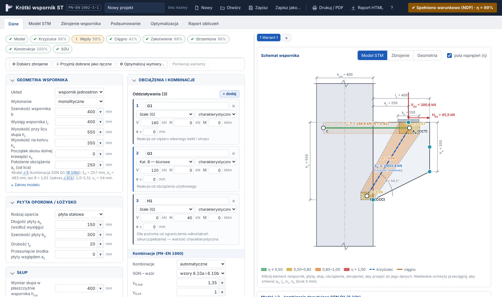

# Krótki wspornik ST

Program do projektowania, wymiarowania i sprawdzania **krótkich wsporników żelbetowych metodą Strut-and-Tie** wg
**PN-EN 1992-1-1** (EN 1992-1-1:2004 + AC:2010, polski Załącznik Krajowy) — §5.6.4, §6.5, zał. J.3, rozdz. 8, 9 i 10.9.5.
Interfejs, sposób pracy i obsługa plików wzorowane na programie **BelkaŻB**: jeden plik `KrotkiWspornikST.exe`
(Windows, WebView2) albo ta sama aplikacja w przeglądarce / jako artefakt claude.ai.

> Wyniki programu wymagają weryfikacji przez uprawnionego projektanta. Pozytywny wynik lokalnego modelu STM nie
> potwierdza nośności słupa, połączenia ani całej konstrukcji.



## Możliwości

| Obszar | Zakres |
|---|---|
| Dane | wspornik jednostronny / dwustronny, stała lub zmienna wysokość (skos od x_s), monolityczny / oparcie prefabrykatu, płyta stalowa / łożysko / oparcie bezpośrednie; słup; materiały i otulina; oddziaływania V, H, M, e_y (charakterystyczne lub obliczeniowe), kombinacje PN-EN 1990 (6.10 / 6.10a,b, SGU) lub ręczne; warianty projektu |
| Schemat | interaktywny rysunek obok formularza: model STM z polami naprężeń w kolorach wykorzystania η, zbrojenie lub sama geometria; klik w element → jego dane; przeciąganie uchwytów a_c, l_c, h_c, h_e |
| Model STM | zał. J.3 / rys. J.5 z jawnym doborem pola naprężeń x_c (1,0 ≤ tan θ ≤ 2,5), kontrola równowagi, stateczności i zgodności rozwiązania zamkniętego z macierzowym; model ręczny dowolnej kratownicy |
| Sprawdzenia | krzyżulce (6.55/6.56), węzły CCC/CCT/CTT (6.60–6.62), docisk (6.63), rozłupywanie (6.58/6.59), cięgno, J.3(1)–(3), V_Rd,c, 6.2.2(6), zakotwienia (8.4, 8.6), gięcie (tabl. 8.1N, (8.1)), otulina (4.4.1), odstępy (8.2), A_s,min/max, oparcia prefabrykatów (10.9.5), rysy (7.3.3 – orientacyjnie) |
| Podsumowanie | tabela sprawdzeń z paskami wykorzystania, statusami SPEŁNIONO / NIE SPEŁNIONO / WYMAGA OSOBNEJ WERYFIKACJI / NIE DOTYCZY, „Jak obliczono” (wzór, oznaczenia, podstawienie), objaśnienia punktów normy, „pokaż →” do danych, odhaczanie |
| Zbrojenie | dobór automatyczny (najmniejsze A_s z wykonalnym zakotwieniem i gięciem), strzemiona J.3(2)/(3) i przeciw rozłupywaniu, rysunek, przekrój, zakotwienia, zestawienie stali |
| Optymalizacja | siatka h_c × l_c × b × klasa betonu × średnice; kryteria: stal, beton, wysokość, wysięg, koszt, η_max; przyjęcie wariantu jednym kliknięciem |
| Raport | pełny lub skrócony, z rysunkami, wzorami i podstawieniami; druk / PDF, HTML, .odt (edytowalny), DXF, JSON, CSV |
| Pliki | projekt `.kwst` (JSON, zgodny z silnikiem Python), autozapis, „Moje projekty” w wersji artefaktu |

Statusy: wynik pozytywny jest **zablokowany** przy błędach danych lub modelu (OBLICZENIA ZABLOKOWANE), przy modelu
poza zakresem J.3 (MODEL POZA ZAKRESEM STOSOWANIA) i bez potwierdzenia parametrów NDP (SPEŁNIONO WARUNKOWO).

## Pobranie i uruchomienie

* **Windows:** `KrotkiWspornikST.exe` z zakładki *Releases* (lub artefakt workflow „Program Windows (.exe)”) —
  jeden plik, bez instalacji. Wymaga Microsoft Edge WebView2 Runtime (obecny w Windows 10/11).
* **Przeglądarka:** `app/app.html` (po zbudowaniu) — otwórz w Chrome / Edge / Firefox.

## Budowa

```bash
python build_html.py
```

tworzy `app/app.html` (program) i `webapp/wspornik.html` (artefakt). Program `.exe` (Go + WebView2, kompilacja
skrośna z dowolnego systemu):

```bash
python tools/make_syso.py
```

```bash
cd app && GOOS=windows GOARCH=amd64 CGO_ENABLED=0 go build -trimpath -ldflags "-H windowsgui -s -w" -o ../dist/KrotkiWspornikST.exe .
```

```bash
python tools/check_exe.py dist/KrotkiWspornikST.exe
```

## Testy

```bash
pip install -r requirements-dev.txt
```

```bash
python -m pytest -q
```

Testy silnika referencyjnego Python (jednostkowe, 12 przypadków kontrolnych, raporty, powtarzalność) oraz **test
krzyżowy**: silnik JavaScript programu liczy te same przypadki co silnik Python i musi dać identyczne werdykty, statusy
i wartości E_d/R_d wszystkich sprawdzeń, to samo zbrojenie i siły modelu (`tests/js/crosscheck.js`). Test interfejsu
w Chromium: `node tests/js/ui_smoke.js`.

## Struktura

```
web/                    program (HTML/CSS/JS): silnik engine_*.js, rysunki draw.js, objaśnienia norm norms.js,
                        interfejs ui.js + views.js, raport report.js, szablon index.html, style
app/                    okno Windows: main.go (WebView2, okna zapisu/odczytu, autozapis), manifest, ikona
build_html.py           budowa app/app.html i webapp/wspornik.html
kwst/                   silnik referencyjny Python (wzorzec testów krzyżowych; python -m kwst projekt.kwst)
tests/                  testy Python + tests/js (test krzyżowy, test interfejsu)
tools/                  eksport danych normowych i przypadków kontrolnych, zasoby .exe, kontrola .exe
docs/                   METODYKA.md, WALIDACJA.md, UZYTKOWNIK.md
```

## Dokumentacja

* [docs/UZYTKOWNIK.md](docs/UZYTKOWNIK.md) — instrukcja obsługi;
* [docs/METODYKA.md](docs/METODYKA.md) — algorytmy, wzory i źródła normowe;
* [docs/WALIDACJA.md](docs/WALIDACJA.md) — macierz walidacji, przypadki kontrolne, status modułów, ograniczenia.
